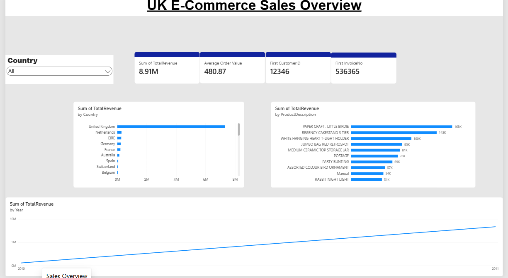
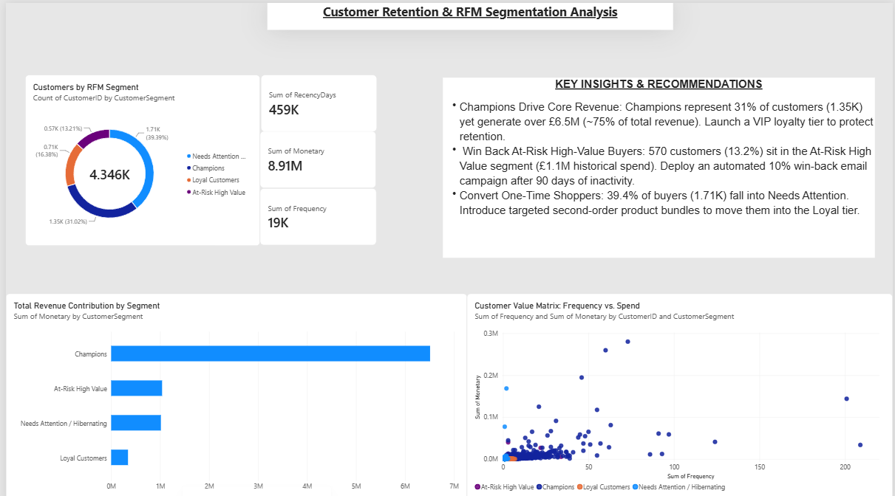

# uk-ecommerce-sql-powerbi-Tableau
End-to-end UK E-Commerce sales &amp; customer retention analysis using MySQL, Power BI and Tableau
# UK E-Commerce Sales & Customer Retention Analysis (MySQL, Power BI & Tableau)

🔗 **[View Interactive Live Dashboard on Tableau Public](https://public.tableau.com/app/profile/khalid.abu.afifeh/vizzes)**

## 📌 Business Overview
An end-to-end data analytics project analysing **500,000+ UK online retail transactions** to uncover seasonal revenue trends, top-performing products, international market opportunities, and customer retention segments using **MySQL**, **Microsoft Power BI**, and **Tableau Public**.

## 🛠️ Tools & Technical Approach
* **Database & Data Cleaning (MySQL):** Imported raw transactional records, filtered out cancelled invoices (`InvoiceNo LIKE 'C%'`), removed missing customer IDs, standardised multi-format dates (`COALESCE` + `STR_TO_DATE`), and engineered `TotalRevenue` metrics.
* **Customer Segmentation (SQL CTEs & Window Functions):** Built an **RFM (Recency, Frequency, Monetary)** model using Common Table Expressions and `NTILE(4)` window functions to classify customers into *Champions*, *Loyal Customers*, *At-Risk High Value*, and *Needs Attention*.
* **Data Visualisation (Power BI & Tableau):** Connected Power BI Desktop directly to MySQL views to build a two-page executive report with custom DAX measures (including Average Order Value), alongside an interactive Tableau Public dashboard.

## 📊 Power BI Dashboard Previews

### Page 1: Executive Sales Overview

### Page 2: Customer Retention & RFM Analysis

## 💡 Key Findings & Business Recommendations
1. **Seasonal Q4 Revenue Surges:** Monthly revenue peaks sharply in November ahead of the holiday season—inventory and marketing spend should scale up in Q3 to capture peak demand.
2. **Protect Core Revenue Drivers:** *Champions* represent **31% of customers (1.35K)** yet generate **over £6.5M (~75% of total revenue)**—launching a VIP loyalty tier will protect core retention.
3. **Win Back At-Risk Buyers:** **570 customers (13.2%)** fall into the *At-Risk High Value* segment (£1.1M historical spend)—deploying an automated 10% win-back email campaign after 90 days of inactivity can recover lost recurring revenue.
